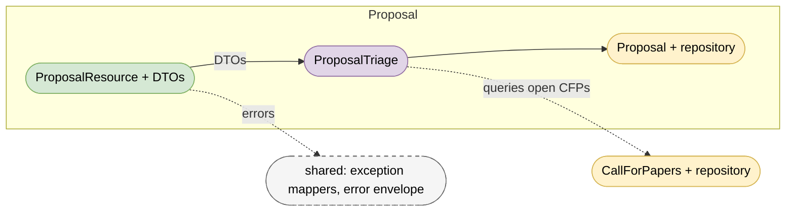
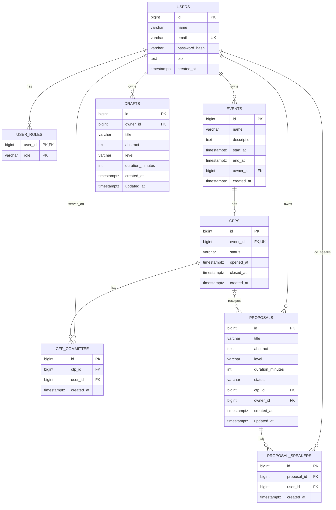
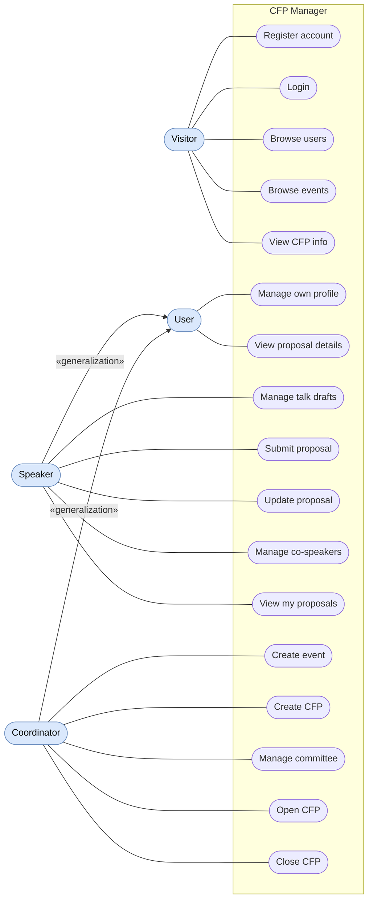

# CFP Manager

CFP Manager is a REST API built with [Quarkus](https://quarkus.io/) for managing the Call for Papers (CFP) lifecycle of tech events.

It connects two kinds of users:

- **Speakers** — register an account and submit talk proposals to open Calls for Papers.
- **Coordinators** — register events, open and manage Calls for Papers, and receive and triage talk proposals.

## Domain

The application covers the end-to-end flow of a Call for Papers:

- **Users** — speaker and coordinator accounts.
- **Events** — conference/meetup registration (name, dates, venue, organizers), managed by coordinators.
- **Calls for Papers** — opening and closing submission windows per event, with tracks, formats and review criteria, managed by coordinators.
- **Drafts** — speaker-owned working copies of talks (`title`, `abstract`, `level`, `durationMinutes`) to prepare proposals before submission.
- **Proposals** — talk submissions (`SUBMITTED` → `EVAL` → `APPROVED` | `REJECTED`) sent to an open CFP, with an owner and optional co-speakers; submitted by speakers and triaged by coordinators. Closing the CFP moves `SUBMITTED` proposals to `EVAL`; other states are kept.

## Endpoints

- `GET /api/coordinators` — list coordinator accounts (`id`, `name`). Public; when called with a valid Bearer token, the caller is excluded from the list.
- `POST /api/coordinators` — register a coordinator account (`name`, `email`, `password`). If the email belongs to an existing user, the `COORDINATOR` role is added only when the password matches (401 otherwise); name is updated, other roles and the password are kept.
- `GET /api/speakers` — list speaker accounts (`id`, `name`). Public; the authenticated caller is excluded when a Bearer token is sent.
- `POST /api/speakers` — register a speaker account (`name`, `email`, `password`, `bio`). Same rule as coordinators: an existing email gets the `SPEAKER` role added when the password matches, with name/bio updated.
- `POST /api/auth/login` — authenticate with `email` + `password`; returns a signed JWT (`token`, `tokenType: "Bearer"`, `expiresIn`). Tokens are RS256-signed; dev/test auto-generate a key pair, production needs `smallrye.jwt.sign.key` + `mp.jwt.verify.publickey` (see `application.properties`).
- `POST /api/events` — create an event (`name`, `description`, `startAt`, `endAt` as ISO-8601 instants). Requires a coordinator token (`@RolesAllowed("COORDINATOR")`); the authenticated coordinator becomes the event `owner`.
- `GET /api/events` — list all events by `startAt`, soonest first. Public.
- `GET /api/events/{id}` — view event details (`id`, `name`, `description`, `startAt`, `endAt`, `ownerId`, `ownerName`, `createdAt`). Public; 404 when the id does not exist.
- `GET /api/events/{eventId}/cfp` — view the event's Call for Papers (`id`, `eventId`, `status`, `openedAt`, `closedAt`, `createdAt`). Public; 404 when the event has no CFP.
- `POST /api/events/{eventId}/cfp` — create the event's CFP (one per event, starts `CLOSED`). Only the event owner; 403 for anyone else.
- `POST /api/events/{eventId}/cfp/open` — open the CFP (`OPEN`, sets `openedAt`). Owner only; 409 when already open or when the committee is empty — at least one member is required.
- `POST /api/events/{eventId}/cfp/close` — close the CFP (`CLOSED`, sets `closedAt`) and move its `SUBMITTED` proposals to `EVAL` (proposals in any other state are unchanged). Owner only; 409 when not open. The CFP can be reopened afterwards.
- `GET /api/events/{eventId}/cfp/committee` — list evaluation committee members (`id`, `userId`, `name`, `createdAt`). Public.
- `POST /api/events/{eventId}/cfp/committee` — add a member (`userId`; any registered user). Owner only; 409 on duplicate, 404 on unknown user.
- `DELETE /api/events/{eventId}/cfp/committee/{userId}` — remove a member. Owner only; 404 when not a member, 409 when it is the last one — a CFP must always keep at least one committee member.
- `GET /api/users/{id}` — public profile of a user (`id`, `name`, `roles`, `bio`); 404 when the id does not exist.
- `GET /api/users/me` — own profile (`id`, `name`, `email`, `roles`, `bio`, `createdAt`). Requires `Authorization: Bearer <token>`.
- `PUT /api/users/me` — update own `name` and `bio`. Requires `Authorization: Bearer <token>`.
- `GET /api/drafts` — list own drafts, newest first (`id`, `title`, `abstract`, `level`, `durationMinutes`, `ownerId`, `ownerName`, `createdAt`, `updatedAt`). Requires the `SPEAKER` role.
- `POST /api/drafts` — create a draft (`title`, `abstract`, `level` — `BEGINNER`/`INTERMEDIATE`/`ADVANCED`, `durationMinutes`; all required). Requires the `SPEAKER` role; the caller becomes the draft `owner`.
- `GET /api/drafts/{id}` — view a draft. Owner only; 403 for any other user, 404 when it does not exist.
- `PUT /api/drafts/{id}` — update any of `title`, `abstract`, `level`, `durationMinutes` (all optional; blank strings and durations below 1 are rejected). Owner only.
- `DELETE /api/drafts/{id}` — delete a draft. Owner only; 204 on success.
- `POST /api/proposals` — submit a talk proposal to an event's open CFP (`eventId`, `title`, `abstract`, `level`, `durationMinutes`; optional `saveAsDraft` also stores a draft copy). Requires the `SPEAKER` role; created directly as `SUBMITTED`. 404 for unknown event/CFP, 409 when the CFP is not open.
- `GET /api/proposals/mine` — list own proposals, newest first, with co-speakers. Requires the `SPEAKER` role.
- `GET /api/proposals/{id}` — view a proposal with its co-speakers (`status`, `cfpId`, `eventId`, `owner`, `speakers`, `draftId` when `saveAsDraft` was used). Requires authentication (any role); 404 when it does not exist.
- `PUT /api/proposals/{id}` — replace `title`, `abstract`, `level` and `durationMinutes`. Owner only and only while the CFP is open; 403 for non-owners, 409 once the CFP closes.
- `POST /api/proposals/{id}/speakers` — add a co-speaker (`userId`; any registered user). Owner only while the CFP is open; 409 on duplicate or when adding the owner, 404 on unknown user.

## Tech stack

- **Java 25** on **Quarkus 3.40**
- **quarkus-rest** for HTTP endpoints (JAX-RS)
- **Hibernate ORM with Panache** (`quarkus-hibernate-orm-panache`) for persistence
- **PostgreSQL** (`quarkus-jdbc-postgresql`)
- **Flyway** (`quarkus-flyway`) for schema migrations
- **JUnit 5 + REST Assured** for tests

## Prerequisites

- JDK 25
- Docker or Podman (only for local development — Quarkus Dev Services auto-starts a PostgreSQL container)

## Running the application in dev mode

```shell script
./mvnw quarkus:dev
```

> **_NOTE:_** Quarkus ships with a Dev UI, available in dev mode only at <http://localhost:8080/q/dev/>.

## Packaging and running the application

```shell script
./mvnw package
```

It produces the `quarkus-run.jar` file in the `target/quarkus-app/` directory.
Be aware that it's not an _über-jar_ as the dependencies are copied into the `target/quarkus-app/lib/` directory.

The application is now runnable using `java -jar target/quarkus-app/quarkus-run.jar`.

If you want to build an _über-jar_, execute the following command:

```shell script
./mvnw package -Dquarkus.package.jar.type=uber-jar
```

The application, packaged as an _über-jar_, is now runnable using `java -jar target/*-runner.jar`.

## Creating a native executable

```shell script
./mvnw package -Dnative
```

Or, if you don't have GraalVM installed, you can run the native executable build in a container using:

```shell script
./mvnw package -Dnative -Dquarkus.native.container-build=true
```

You can then execute your native executable with: `./target/c4p-manager-1.0.0-SNAPSHOT-runner`

If you want to learn more about building native executables, please consult <https://quarkus.io/guides/maven-tooling>.

## Data access

The application uses **Hibernate ORM with Panache** (`quarkus-hibernate-orm-panache`) on top of a **PostgreSQL** datasource (`quarkus-jdbc-postgresql`).

- In dev and test mode, [Dev Services](https://quarkus.io/guides/datasource#dev-services) automatically starts a PostgreSQL container — no configuration needed (requires Docker/Podman).
- In production, set `DATABASE_URL`, `DATABASE_USER` and `DATABASE_PASSWORD` (see `src/main/resources/application.properties`).
- Schema migrations are managed by [Flyway](https://quarkus.io/guides/flyway) (`quarkus-flyway`): SQL files in `src/main/resources/db/migration` (`V<n>__<description>.sql`) run automatically on startup in every profile. Hibernate schema generation is disabled; `schema-management.strategy=validate` makes Hibernate verify entity mappings against the migrated schema at startup.

Entities are plain JPA classes with public fields; data access goes through `PanacheRepository` beans (repository pattern — no active record). See the [Hibernate ORM with Panache guide](https://quarkus.io/guides/hibernate-orm-panache).

## Testing

```shell script
./mvnw test                              # unit tests
./mvnw verify -DskipITs=false            # unit + integration tests
```

The `quarkus-jacoco` extension instruments application classes during tests and generates a coverage report (HTML/XML/CSV) in `target/jacoco-report/` — open `target/jacoco-report/index.html`. Execution data is stored in `target/jacoco-quarkus.exec`. Tune it via `quarkus.jacoco.*` properties (e.g. `quarkus.jacoco.report=false` to disable report generation).

## Architecture

The codebase follows **BCE (Boundary/Control/Entity)**, organized feature-first: each business capability is a top-level package under `com.dearrudam`, split into three layers.

- `boundary` — presentation: JAX-RS resources mounted under `/api`, request/response DTO records, entity↔DTO mappers, exception mappers.
- `control` — business logic: use-case classes named after their responsibility that orchestrate entities and enforce domain rules.
- `entity` — domain and persistence: Panache entities and Panache repositories.

Dependencies point inward: `boundary → control → entity`. The entity layer never depends on control or boundary, and the boundary never exposes entities — DTO mapping happens at the resource. Features may interact through each other's `control`/`entity` classes; cross-cutting code (exception mappers, error envelope) lives in `shared`.

Every feature (`user`, `event`, `cfp`, `draft`, `proposal`) follows the same pattern:



## Diagrams

### Data model



### Use case diagram



Public use cases (register, login, browse users/events, view CFP info) are also reachable by authenticated users; role-specific use cases follow the JWT `upn` identity — Speaker for drafts/proposals, Coordinator plus event ownership for CFP management.

## Project structure

```text
src/main/java/com/dearrudam/
  user/        # speaker/coordinator accounts
    boundary/  # REST resources + DTOs
    control/   # business logic
    entity/    # Panache entities + repositories
  event/       # event registration and management (same BCE layout)
  cfp/         # call for papers lifecycle (same BCE layout)
  draft/       # speaker-owned talk drafts (same BCE layout)
  proposal/    # talk proposal submission and triage (same BCE layout)
  shared/      # cross-cutting concerns (exception mappers, error envelope)
src/main/resources/
  application.properties             # configuration (env-var driven)
  db/migration/                      # Flyway migrations (V<n>__<description>.sql)
src/test/java/com/dearrudam/        # JUnit tests (mirrors BCE packages)
src/main/docker/                    # container Dockerfiles
```
